# KaizenFlow

KaizenFlow is the light version of [LoomFlow](loomflow.md). The operating instructions are in [the command](../claude/commands/kaizenflow.md) and [the reviewer](../claude/agents/kaizen-reviewer.md). This file records why the flow has this shape and how to verify it.

Regenerate the diagram with `python3 scripts/generate-kaizenflow-diagram.py`. Use `--check` to detect a stale SVG. The operating instructions remain the source of truth.

## Baseline

Source: 51 Claude Code sessions with LoomFlow roles, and 88 retro rows, up to 2026-11-05. Codex runs are not included. Some sessions also hold other chat. Tokens are weighted by the formula in `scripts/flow-cost.py`, which ignores the price of each model.

Median run: 2.10M weighted tokens, 58 active minutes, 55 orchestrator calls.

| Role | Share of tokens | Median active minutes per run |
| --- | --- | --- |
| Orchestrator | 41% | not separated |
| Builders | 36% | 47 (`pr-builder`), 20 (generic builder) |
| Reviewers | 14% | 2.7 and 2.4, in parallel |
| Analyzer | 7% | 11.5 |
| Merge gate | 2% | 6.1 |

## What the data changed

- The orchestrator is the largest cost, and it is not thin: its median peak context is 120K tokens. Of its cost, 66% is cache reads, which is calls times context size. Cache rewrites after long waits are only 8%. So KaizenFlow removes steps and handoffs, and has a context budget.
- Prompt length is a small cost. The LoomFlow command and spec are about 7K tokens of a 120K context. Reviewers read the spec in only 16 of 193 starts, so most of its rules did not act on them.
- Review is cheap and accurate, so it stays. Of 91 findings with a parsed outcome, 83 were fixed. The review is not the place to save.
- The second reviewer rarely adds a result. In 48 paired rounds, 35 were clean, and reviewer B alone found something in 2. Two reviewers remain for `deep` only.
- Round 2 is 35% of review starts and 16% of outcomes. It runs only when a fix has reach.
- Size stopped carrying information: 64 of 88 retro rows were Major, because path rules raise the size. Depth is now a judgement of what a mistake costs.
- The analyzer starts cold and waits on full checks. The analyzer and gate spent over 5 hours in `make check`. The context that wrote the code now fixes the findings, runs only the affected tests, and leaves full proof to CI.
- The gate is mechanical, so it is a script. It stays a script and not one line, because `gh pr checks --watch --fail-fast` exits 0 for cancelled checks, and `master` in Triangulator has no branch protection.

## What stays from LoomFlow

No merge with an open `blocker` or `major` or a failed check, exact head merge, at most two rounds, a fresh read-only reviewer, and a retro row on every exit.

## What KaizenFlow gives up

- Audit comments from each role. One comment remains, and only when the review found something.
- A separate analyzer. The author now judges findings on its own code, so a wrong rebuttal is more likely. A rebutted `blocker` therefore triggers round 2.
- A second opinion on most changes. By the baseline, about 2 of 13 rounds with findings would lose those findings.
- `quick` has no independent review. The 5 Small rows in the retro were all clean, but that sample is small.
- Major series, design rounds, and two design tracks. Use LoomFlow for that work.

## Selective checks

`$HOME/ai/scripts/kaizen-checks.sh` is the one place that decides which checks a change needs. The builder, the fixer, and CI all call it, so the local result and the CI result agree. It reads `.kaizen-checks` in the repository root. Each check lists the globs that trigger it, and the dependents of its inputs belong in those globs: that is the blast radius.

- Safe by default. A changed file that no rule names runs every check. A rule file entry `@all` (build config, shared headers, the rules file itself) also runs every check. Only `@skip` globs, such as docs, run nothing.
- Quality gate. `--all` runs every check. Use it as a scheduled or `--no-ci` run, so a wrong glob cannot hide a defect for long.
- Cost. Glob matching is the only logic, so the script needs no build graph. A glob that is too narrow is the failure mode: review the rules file as code.

Use `--list` to see the selection without running it, and `--base REF` to change the comparison point. In CI, fetch full history and pass the base: see `.github/workflows/checks.yml`.

## Verify

The expected gain is a target, not a result: at least 40% fewer weighted tokens per median run, with no rise in defects after merge.

1. Run KaizenFlow on about 10 real changes. Include at least 2 at `deep`.
2. Run `python3 scripts/flow-cost.py --since <trial start>` and compare the two rows.
3. Read the `lesson` column. Apply one subtraction.

To test `kaizen-checks.sh`, change one file per rule in a scratch clone and run `$HOME/ai/scripts/kaizen-checks.sh --base main --list`. Check a mapped file, a skipped file, a shared file, and an unmapped file.

To test `kaizen-merge.sh` safely, put a stub `gh` on `PATH` that passes reads to the real `gh` and only prints `pr merge`. Run it on PRs with failed, cancelled, and passing checks.
