# KaizenFlow

The KaizenFlow operating instructions are in [the command](../claude/commands/kaizenflow.md) and [the reviewer](../claude/agents/kaizen-reviewer.md). This file records the reasons for the workflow and how to verify it.

Regenerate the diagram with `python3 scripts/generate-kaizenflow-diagram.py`. Use `--check` to detect a stale SVG. The operating instructions remain the source of truth.

## Baseline

Source: 51 Claude Code sessions with LoomFlow roles, and 88 retro rows, up to 2026-11-05. Codex runs are not included. Some sessions also hold other chat. Tokens are weighted by the formula in `scripts/flow-cost.py`, which ignores the price of each model.

Median run: 2.10M weighted tokens, 58 active minutes, 55 orchestrator calls.

| Role | Share of tokens | Median active minutes per run |
| --- | --- | --- |
| Orchestrator | 41% | not separated |
| Builders | 36% | 47 (`pr-builder`), 20 (generic builder) |
| Reviewers | 14% | 2.7 and 2.4, in parallel |
| Analyzer | 7% | 11.5 |
| Merge gate | 2% | 6.1 |

## What the data changed

- The orchestrator is the largest cost, and it is not thin: its median peak context is 120K tokens. Of its cost, 66% is cache reads, which is calls times context size. Cache rewrites after long waits are only 8%. So KaizenFlow removes steps and handoffs, and has a context budget.
- Prompt length is a small cost. The LoomFlow command and spec are about 7K tokens of a 120K context. Reviewers read the spec in only 16 of 193 starts, so most of its rules did not act on them.
- Review is cheap and accurate, so it stays. Of 91 findings with a parsed outcome, 83 were fixed. The review is not the place to save.
- The second reviewer rarely adds a result. In 48 paired rounds, 35 were clean, and reviewer B alone found something in 2. Two reviewers remain for `deep` only.
- Round 2 is 35% of review starts and 16% of outcomes. It runs only when a fix has reach.
- Size stopped carrying information: 64 of 88 retro rows were Major, because path rules raise the size. Depth is now a judgement of what a mistake costs.
- The analyzer starts cold and waits on full checks. The analyzer and gate spent over 5 hours in `make check`. The context that wrote the code now fixes the findings, runs only the affected tests, and leaves full proof to CI.
- The gate is mechanical, so it is a script. It stays a script and not one line, because `gh pr checks --watch --fail-fast` exits 0 for cancelled checks, and `master` in Triangulator has no branch protection.

## Proof over review

Review costs a full read for each round, and finds only what a reader notices. A test, a verification journey, or a formal check costs one run, and catches the same defect on every later change. So KaizenFlow moves effort to the start and the proof:

- Specify first. Each acceptance criterion names its proof. At `deep`, each invariant names its formal check.
- A proof plan before code. Each check that the change touches is created, updated, kept, or removed, by its value against its cost. The decision tables live in `create-formal-verification-skill/references/techniques.md`, one source for the command and the skill.
- TLA+ by judgement, not by default. Writing a model is the cost, and each rerun is cheap, so a model pays when the bug can hide in an order of events and the area will change again. Then it guards against regressions on every later change. Other risks get a cheaper check: a property test, a code verifier, or a table test. The PR body records the choice and the reason in one line, so the retro can show when the choice was wrong.
- Tests come before code and must fail without the change (`tdd`).
- Verification skills are code. A PR that changes a covered feature or verified code updates the skill in the same PR. Create one in a separate PR when a repository will get more changes of that kind.
- `deep` uses one reviewer and formal checks, not two reviewers. In the baseline, reviewer B alone found something in only 2 of 48 paired rounds. A second reviewer remains for a risk that no proof covers.
- The reviewer reads the spec and the proof first. A gap in the proof is a `major`.

Per-PR updates keep the skills in step with the changes that KaizenFlow makes. Changes made outside KaizenFlow still cause drift. Run `maintain-verification-skill` and `maintain-formal-verification-skill` after large merges, or on a schedule.

## TODO

Gaps from the review of 2026-11-23. Each one needs a script or a rule before it can replace judgement.

- Link models to code in CI: map each model to the globs of its covered code in `.kaizen-checks`, so a code change reruns the model.
- Keep the spec in the repository: invariants, models, and property tests next to the code, with the PR body linking to them. Add a check that fails when an invariant has no linked test or model.
- Design for proof: one state type and a pure transition function, idempotent operations, and injected time. Consider `principle-make-operations-idempotent` and `principle-separate-before-serializing-shared-state` from pstack.
- Mutation testing at `deep`: run a mutation tool on the changed lines through `.kaizen-checks`. A surviving mutant is a finding.
- Measure the formal choice: add `formal` and `escaped` columns to the retro TSV with a header migration, and report them in `scripts/flow-cost.py`.
- At `standard`, name in one line the existing invariants that the change touches.

## Trade-offs

- Audit comments from each role. One comment remains, and only when the review found something.
- A separate analyzer. The author now judges findings on its own code, so a wrong rebuttal is more likely. A rebutted `blocker` therefore triggers round 2.
- A second opinion on most changes. By the baseline, about 2 of 13 rounds with findings would lose those findings.
- A second reviewer at `deep`. A formal check replaces it. The check covers only its stated model and bounds, so a risk outside them still gets a second reviewer.
- More time before the first push. Specs, failing tests, and models cost time that review used to take. The trial must show fewer weighted tokens and no rise in defects after merge.
- `quick` has no independent review. The 5 Small rows in the retro were all clean, but that sample is small.
- KaizenFlow has no workflow for a series of PRs or separate design rounds.

## Structure checks

Deep modules with narrow interfaces make proof cheaper: a type that keeps its fields owns its invariant, so one check at one boundary guards it. KaizenFlow keeps this as a nudge and a reviewer question, not a rule, because the tools are language-specific and new. When a repository adopts a structure linter such as [`deslop-please`](https://github.com/deterministic-machines/deslop-please), start from a baseline allow file and let it only shrink. A new error then fails `.kaizen-checks`.

## Selective checks

`$HOME/ai/scripts/kaizen-checks.sh` is the one place that decides which checks a change needs. The builder, the fixer, and CI all call it, so the local result and the CI result agree. It reads `.kaizen-checks` in the repository root. Each check lists the globs that trigger it, and the dependents of its inputs belong in those globs: that is the blast radius.

- Safe by default. A changed file that no rule names runs every check. A rule file entry `@all` (build config, shared headers, the rules file itself) also runs every check. Only `@skip` globs, such as docs, run nothing.
- Quality gate. `--all` runs every check. Use it as a scheduled or `--no-ci` run, so a wrong glob cannot hide a defect for long.
- Cost. Glob matching is the only logic, so the script needs no build graph. A glob that is too narrow is the failure mode: review the rules file as code.

Use `--list` to see the selection without running it, and `--base REF` to change the comparison point. In CI, fetch full history and pass the base: see `.github/workflows/checks.yml`.

## Opening the PR with `/ship`

[`/ship`](https://code.claude.com/docs/en/ship-command) is a Claude Code CLI command, from v2.1.330, in a local clone only. Cloud sessions do not have it. It can commit, push, open a GitHub pull request, run `/code-review` in the same session, and watch the PR to work on failing checks and comments. It does not merge. Once the PR is ready, you merge it yourself.

KaizenFlow uses it only to open the PR and, briefly, to tend failing checks before the independent review. It does not replace `kaizen-reviewer` or `kaizen-merge.sh`.

Reasons:

- A fresh reviewer is cheap and accurate in the baseline, and it must not share the author's context. `/ship`'s `/code-review` runs in the session that wrote the code.
- The watch can push after that review, which would leave an unreviewed head. The merge script takes a specific SHA, so the watch must stop before `kaizen-reviewer` starts, and must not run at merge.
- "Push once" still applies to unfinished work. The watch may add CI fix-up pushes, but only before the independent review, and then it stops.
- A watch uses your `gh` and `git` sign-ins and can lead to a merge if auto-merge is on, or if you type in auto mode and branch rules let you merge without another person. Merge stays a script so cancelled checks cannot pass, which is why `kaizen-merge.sh` exists.

The organization product also called [Claude Ship](https://claude.com/resources/articles/introducing-claude-ship) (Code Review, PR Steward, and Claude Approvals, on Team and Enterprise plans) is separate. Do not turn on Claude Approvals or repository-wide PR Steward for KaizenFlow work: Approvals can approve outside this flow, and where PR Steward is already on a PR, a local `/steward` watch will not start.

If `/ship` is missing or will not push, open the PR by hand, as before.

## Verify

The expected gain is a target, not a result: at least 40% fewer weighted tokens per median run, with no rise in defects after merge.

1. Run KaizenFlow on about 10 real changes. Include at least 2 at `deep`, with one formal check.
2. Run `python3 scripts/flow-cost.py --since <trial start>` and compare the median with the baseline above.
3. Read the `lesson` column. Apply one subtraction.

To test `kaizen-checks.sh`, change one file per rule in a scratch clone and run `$HOME/ai/scripts/kaizen-checks.sh --base main --list`. Check a mapped file, a skipped file, a shared file, and an unmapped file.

To test `kaizen-merge.sh` safely, put a stub `gh` on `PATH` that passes reads to the real `gh` and only prints `pr merge`. Run it on PRs with failed, cancelled, and passing checks.
