# LoomFlow

- This is the tool-neutral build and review workflow. Use `git` and `gh`; take checks, standards, and sensitive paths from the repository's `AGENTS.md`.
- Diagram:  This is a generated view of this file. This file is canonical. Regenerate with `python3 scripts/generate-loomflow-diagram.py` after a change to the workflow.
- Claude Code adapter: [command](../claude/commands/loomflow.md) and [role prompts](../claude/agents/).
- Roles: orchestrator refines the requirement, sizes, decides, and coordinates; builder (Major only) designs and builds; reviewers stay read-only; analyzer fixes or rebuts; test-and-merge runs the gate once.
- Only the user starts a run. Roles never start LoomFlow. Maximum: two review rounds and one merge gate.
- `<state>` is `${XDG_STATE_HOME:-$HOME/.local/state}/loomflow`. Only the orchestrator writes there.

## Modes

- `<task>`: build mode. Refine the requirement, build, open the PR, then run review mode on it in the same run.
- `<PR> [full|scan]`: review mode only.
- Autopilot is the default. Supervised mode applies only when the user asks for it before the task starts. Then the user approves the plan or design note, and the start of the gate.

## Requirement (build mode, step 0)

- Before sizing, the orchestrator applies `$HOME/ai/skills/FiveCsReview/SKILL.md` to the task or bug report. It reads only what is needed to check the requirement. It does not design.
- In every mode, autopilot too, ask the user about each gap that the skill says to ask about, in one message, and wait for the answers.
- When an answer is obvious, do not ask. Record it as an assumption in the `## Requirement` block in the PR body, and list the assumptions in the thread before sizing.
- Supervised mode: the user approves the refined requirement before sizing.
- The `## Requirement` block is the source of truth for the run. Put it at the top of the PR body. Pass it to the builder in place of the raw task. Its acceptance criteria are the proof list for the builder and the requirement check for reviewers.
- A change to the requirement after this step (from the user or a design review) updates the block in the PR body.

## Build mode

- Decide the size after the requirement step, before any other work, from the planned change and the "When" column below. Review mode uses this size when it is larger than its own triage.
- For a bug, the builder attempts to reproduce the reported behavior and investigates its root cause using the available evidence before design or implementation. Read `principle-fix-root-causes`. Record the steps, results, evidence, and cause in the PR body, and pass them to the design reviewer when applicable. If reproduction or the cause remains unconfirmed, record what was tried, the limits, and the uncertainty; do not present a hypothesis as a confirmed cause. Continue with the available evidence, and update the requirement if the findings change it.
- Small: delegate the build to the Small builder; it builds and opens a PR to the repository base branch. Normal: delegate the build to the Normal builder; it opens a PR with a plan of 3 to 5 lines in the PR body. A Major change that is Major only for its path or area is built as Normal, and keeps the Major review.
- Major build (a new feature or redesign, or more than 300 changed code lines): the orchestrator stays thin. It sizes, decides, delegates, and checks results. A fresh builder does all exploration, file reads, edits, and proof.
  1. The builder opens a draft PR. Its body is the `## Requirement` block, the bug investigation when applicable, and the minimal design note: x over y and why; what is deleted; the one fact that makes the change safe. Decide only what blocks the first verifiable unit.
  2. One reviewer uses the design reviewer model and effort below. Over-design is a finding. The builder revises once. Run design round 2 only when a design `blocker` is not `FIXED`. Never run a third. An open design `blocker` after round 2 stops the run.
  3. The builder builds, proves, writes the safety fact and its proof in the PR body, and marks the PR ready.
- Major series (more than one PR): PRs target a feature branch and gate on the local check. The orchestrator cancels their automatic CI runs. After each merge, it writes the decisions and open items to the trail file, `<state>/<owner>-<repo>-<feature branch, "/" as "-">.md`, and continues from that file. One final sync PR to `master` runs full CI.
- Major redesign series (a series that replaces a user-visible surface): after the last PR merges into the feature branch, the orchestrator stops and reports. The user tests the feature branch personally. The orchestrator opens the final sync PR only when the user asks, and the user merges it.
- Proof: tests and short DOM facts (`evaluate`). Take screenshots only for a major UI redesign, as few as needed, saved to a file.
- Rewrite or delete, in the same PR, a test that is pinned to the implementation and blocks the change.
- Context rules are guidance only: give role prompts by pointer ("read <role file> and follow it" plus inputs), load only the tools a step needs, and record model IDs once.

## Skills per phase

Read each skill in `$HOME/ai/skills/` (with or without the `principle-` prefix) at the step it governs.

- Requirement: FiveCsReview.
- Bug investigation: fix-root-causes.
- Design (Major): redesign-from-first-principles, foundational-thinking, model-the-domain, subtract-before-you-add, laziness-protocol, blast-radius.
- Build: sequence-verifiable-units, laziness-protocol, test-behavior-not-implementation, minimize-reader-load, boundary-discipline, migrate-callers-then-delete-legacy-apis, type-system-discipline (C++).
- When stuck: fix-root-causes; attack-the-premise after two failed fixes with one premise.
- Prove: prove-it-works, build-the-lever, create-verification-skill when the repository has none.
- Review: test-behavior-not-implementation, subtract-before-you-add.
- PR text: unslop. Retro: encode-lessons-in-structure, guard-the-context-window.

## Select the review

- Use `scan` only when no sensitive path changes and either all files are documentation or at most 30 lines change in at most three files.
- Sensitive paths include CI, build files, dependency manifests/locks, auth/secrets, storage/wire formats, and the repository's list. Documentation on these paths still needs `full`.
- Use `full` for every other change or any doubt. A user-requested `full` cannot be downgraded.
- `scan` uses one reviewer. `full` uses two reviewers in parallel on the same head SHA.

## Model and reasoning selection

Pick the models from the size of the change. Pass the model and effort to every role. Role files set no model or effort.

| Size | When | Builder | Reviewer A | Reviewer B | Analyzer | Gate |
| --- | --- | --- | --- | --- | --- | --- |
| Small | `scan` | Sonnet 5.5, high | Sonnet 5.5, high | none | Sonnet 5.5, high | Sonnet 5.5, high |
| Normal | other `full` changes | Sonnet 5.5, high | Opus 5.5, medium | Sonnet 5.5, high | Sonnet 5.5, high | Sonnet 5.5, high |
| Major | a new feature or redesign; any change on a sensitive path; concurrency, storage, wire format, auth, or secrets; or more than 300 changed code lines | Opus 5.5, medium; Normal builder when Major only for path or area | Sonnet 5.5, high | Opus 5.5, medium | Sonnet 5.5, high | Sonnet 5.5, high |

- Changed code lines are added plus modified lines. Deleted test lines do not count: removing tests for removed behavior adds no risk, and counting it made cleanups Major.
- Use different models for A and B when possible. In any doubt between two sizes, use the larger one.
- Apply the model and reasoning limits in `AGENTS.md` to every role and fallback. For coding work, including code reviews and writing tests, use Sonnet 5.5 `high` or Opus 5.5 `medium`. If the selected model is unavailable, use the other. If both are unavailable, stop and report.
- UI/UX design review uses Astra 6 `medium`, with Opus 5.5 `medium` as fallback. This role does not require a different model family or an increase to `high`. It gives no Astra exception for code review or build.
- For non-coding work, choose the model and reasoning effort to suit the task. Use GPT 6.1 Terra only at `high`.
- Non-UI Major design review: use the Major Reviewer A model. Use a different model from the builder when possible. Apply the model fallback above when needed.

## Agent communication

- Use direct agent messages or the runner's returned task result for all internal reports. The orchestrator passes the complete report to the next role. A completion notice, finding count, or comment URL alone is not a report.
- Review reports contain the PR, role, mode, round, reviewed head SHA, and every finding, or explicit `No findings.` Each finding has its ID, severity, path and line, failure scenario, evidence, and fix direction. Use the existing `D`, `R`, and `Q` IDs. Reviewers work independently; do not send one reviewer's findings to another before both have reported.
- The orchestrator requires each expected report for the correct PR, mode, round, and head SHA. Missing, incomplete, or mismatched direct reports stop the run. Never recover internal findings from GitHub comments.
- Pass the deduplicated findings to the analyzer in its task input. Preserve every source ID and its evidence, including open scan findings. Pass design findings to the builder in the same way. Pass the analyzer's complete result and both SHAs to round 2 reviewers.
- Analyzer results contain the PR, round, input and output head SHAs, each finding ID and its `FIXED`, `REBUTTED`, or `OUT-OF-SCOPE` outcome, commit or evidence, and all remaining open findings. Builder and gate results include the PR, head SHA, and phase or gate outcomes. Do not shorten reports to meet a final-message line limit.
- The orchestrator still reads user-raised PR issues and passes them to the responsible role as `U-<n>` findings with the user's severity, or `major` if unspecified. Check them again before the gate. Roles still read PR metadata, the requirement, code, and CI as needed; review and analyzer comments are audit copies only.
- Each role attempts its existing audit post with the same findings or outcomes. Include the audit URL, or the posting error, in the direct result. An audit posting failure does not block or clear a finding, change a gate result, or suppress the direct report. Report audit gaps or discrepancies to the user; direct results control the run.
- Use the runner's message or task-result channel. If it has no direct result channel, stop and report; do not substitute GitHub comments or create a new message service.

## Review method

- Report only blocker and major findings. Check callers, readers, failure paths, boundaries, and regression coverage.
- An acceptance criterion in the `## Requirement` block that the change does not meet, or does not prove, is a finding.
- Try to disprove each finding before posting it. Drop it if a guard, caller, or test prevents the failure.
- The deep reviewer checks PR claims and the fact that makes the change safe, including the fact and proof that the builder states. Measurements count only when error-free runs execute the changed code.
- Reviewers run no builds or tests. They leave HEAD and worktree unchanged.
- Collect each required direct review report under "Agent communication". PR comments provide the audit record.

## Rounds

- For `scan`, no blocker/major means proceed to checks and gate.
- A scan finding escalates to full round 1 with both reviewers on the whole diff. Keep the scan findings open for the analyzer even if later reviewers find none.
- For `full`, collect both direct review reports on the same head SHA.
- With no blocker/major, apply check reuse, then proceed to the gate. Stop at the first failed check.
- With findings, start one analyzer with their deduplicated union in its task input. Use its direct result to update findings. Check quick-reviewer findings with extra care.
- The analyzer reads CI at start and before pushing. Each failed check is a blocker: read its log and fix its cause. Never rerun CI.
- Before fixing behavior, add a regression test and confirm failure without the fix when a cheap local target exists. Run only that test for this step.
- If round 1 changes HEAD, run round 2 on the fixes and new commits only. Check their callers too. Pass the original and new SHAs.
- After round 2, any open blocker/major or user-raised critical issue stops the run for manual handling.
- No third round, second gate, or automatic restart. Report commits pushed after the last review as unreviewed.

## Reuse passing checks

- Compare code, tests, build configuration, and base inputs. Reuse a passing local or CI result that covers the combined inputs.
- If CI already checks those inputs, wait for it. Do not run another full suite locally or update the branch just to trigger checks.
- For documentation or generated-summary conflicts, preserve both changes and run the affected documentation check. Reuse full results if build/test inputs did not change.
- If base code changed, verify the combined code once through CI or a local run.
- AlmaLinux reuse is implemented in [ci-reuse.py](../.github/scripts/ci-reuse.py). It excludes documentation, retains test fixtures, and checks untested base changes. Missing evidence requires full tests; manual/nightly runs always test.

## Gate (once)

- Confirm the expected head SHA and a clean worktree.
- Apply check reuse. Run the repository check on a throwaway merge only when no passing result covers the combined inputs.
- Run affected documentation checks for documentation changes. A full review tier alone does not require a full build.
- Require CI pass/skipping, or recorded passing coverage for a pending duplicate. Never ignore failures. Stop waiting when any check fails.
- No reported checks pass only when no changed file matches a pull-request path filter.
- Require `MERGEABLE` and `CLEAN`. A covered pending duplicate may leave `UNSTABLE`; use normal merge and respect required branch checks.
- In a Major series PR, a CI run that the orchestrator cancelled is not a failure, and it may leave `UNSTABLE`.
- Merge with `--match-head-commit`. Never use `--admin` or force.
- Report a failed gate without retrying or starting another fix pass.

## Retro

- On every exit, also a stop or failure, the orchestrator appends one row to `<state>/<owner>-<repo>.tsv`. A new file starts with the header row.
- Tab-separated columns: `date`, `mode`, `size`, `task_or_pr`, `rounds`, `blockers`, `majors`, `gate`, `outcome`, `models`, `peak_context`, `lesson`.
- Write `-` for an unknown value, such as `peak_context` when the runner does not report it. `lesson`: one change that would have prevented a stop or extra round, or `-`.

## PR comments

These headers identify audit copies. Do not use these comments to transfer internal findings or decide whether a role has completed.

- Design reviewer: `## Design review, round <n>`.
- Reviewer: `## Review, round <n>, head <SHA>`.
- Quick reviewer: `## Quick review, round <n>, head <SHA>`.
- Analyzer: `## Analyzer, round <n>`.
- Test and merge: `## Merge gate, head <SHA>`.
